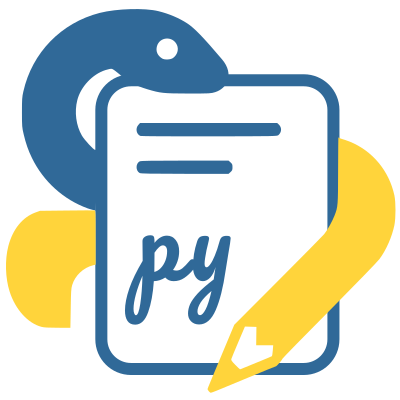

# Pytition

<!-- markdownlint-disable MD033 -->

  

<!-- markdownlint-enable MD033 -->

## Why using Pytition?

- Because it allows you to host petitions without compromising the privacy of your signatories.
- No tracking, ever: CSS, JS and all resources are self-hosted. Pytition does not use CDN.
- Nice UI: Bootstrap 4 + JQuery 3.
- Based on solid backend technology: Django.
- Responsive UI: works well on phones/tablets/laptops/desktops.
- If you host an instance of Pytition, you can guarantee your signatories that their information won't leak to third parties.
- It is Open Source and Free Software.

## Features

- [x] Multi-lingual UI with i18n: English, French, Italian, Occitan, Spanish.
- [x] You can pre-visualize petitions before publishing them.
- [x] Easy to use: petition content is typed-in via TinyMCE editors (like WordPress).
- [x] You can setup real SMTP account for the confirmation e-mail so that it is less likely considered as SPAM.
- [x] Supports Open Graph tags to provide description and image to allow nice cards to be shown when people post the petition link on social networks.
- [x] You can propose your signatories to subscribe to a newsletter/mailinglist (via HTTP GET/POST or EMAIL methods).
- [x] You can export signatures in CSV format.
- [x] Support for several organizations on the same Pytition instance [v2.0](https://github.com/pytition/Pytition/milestone/2)
  - [x] Fine grain per-user per-organization permissions
- [x] Email retry support through the use of a mail queue middleware
- [x] Nice (multiple) permalink support for each petition
- [x] Optional share buttons

## Future features

- [ ] Support for multi-lingual petition content: [v3.0](https://github.com/pytition/Pytition/milestone/3)
- [ ] Support for adding several petition templates: [v4.0](https://github.com/pytition/Pytition/milestone/4)
- [ ] Add optional Diaspora share icon

## Install development environment

See [dev/CONTRIBUTE.md](dev/CONTRIBUTE.md)

## Documentation (Installing in production, configuration, update etc)

See [pytition.readthedocs.io](https://pytition.readthedocs.io).

## Included dependencies

Those are external projects that are needed and used by Pytition, but included in Pytition source tree:

- Bootstrap 5.3.8
- TinyMCE 7.9.2

## Dependencies

- `Python` 3.8 up to 3.11
- `Django` 5.2.x
- `django-tinymce` 5.0.0
- `django-colorfield` 0.10.1
- `requests` 2.20.x
- `mysqlclient` 2.0.1
- `django-formtools` 2.2
- `bcrypt`

## Translations

| Language |                                                                    Translation %                                                                    |
| :------: | :-------------------------------------------------------------------------------------------------------------------------------------------------: |
| English  |  |
|  French  |  |
| Italian  |  |
| Occitan  |  |
| Spanish  |  |
