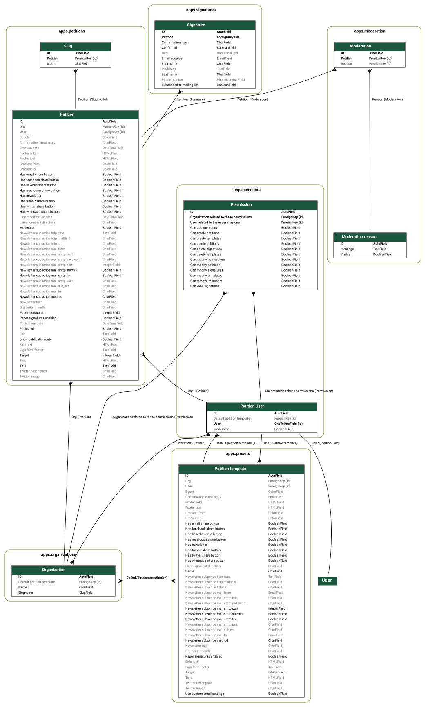

# Architecture Overview

This document provides an overview of the architecture of the Pytition application, including its main components and their interactions.

## Apps

This application is built using the Django framework and is organized into several apps, each responsible for a specific area of functionality:

- **Accounts**: Manages user authentication, profiles, and permissions.
- **Organizations**: Handles organization creation, management, and membership.
- **Petitions**: Core functionality for creating, managing, and signing petitions.
- **Signatures**: Manages the collection and validation of petition signatures.
- **Presets**: Provides predefined templates and settings for petitions.
- **Moderation**: Tools and workflows for moderating content and user activity.

## Models

The data model is structured around the main entities of the application, with relationships defined between them.

This is a simplified diagram of the main models and their relationships:

