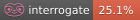

# Dev guide

Doc coverage : 

Welcome to the developer documentation!

:::{admonition} Who is this section for?
:class: tip
For developers who want to contribute to the codebase.
:::

## Getting Started

```{todo}
Implement developer guide content here.
```

## Wat's next?

```{toctree}
:maxdepth: 2
:caption: Contents:

conventions/index
setup
architecture
```
